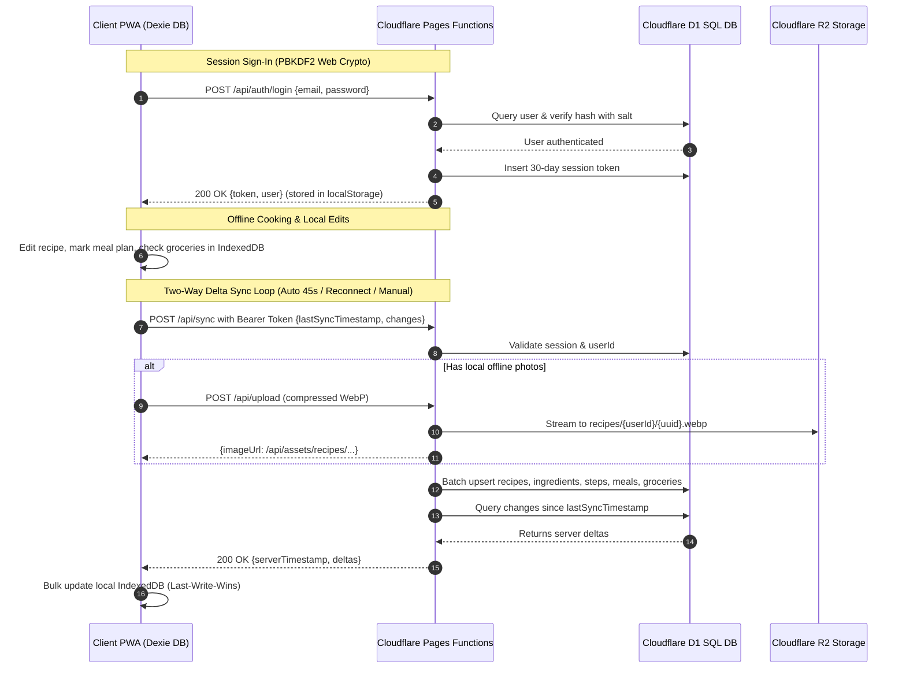

# "My Cookbook" - Cloudflare Sync Sessions Walkthrough

This walkthrough details the native **Cloudflare Sync Sessions** engine for **"My Cookbook"**. The architecture combines an offline-first **Dexie (IndexedDB)** local store with a zero-maintenance, zero-third-party **Cloudflare D1** relational database, **Cloudflare R2** asset storage, and **Cloudflare Pages Functions**.

---

## 1. Interface & UI Indicators

- **Cloud Status Icon (Top Right Header):**
  - **Connected:** Delicate strawberry-pink cloud with a green active indicator dot.
  - **Syncing:** Animated spinning sync icon while uploading deltas or pulling updates.
  - **Offline:** Muted offline cloud icon with automatic fallback to local IndexedDB.
- **Settings Modal (`/settings`):**
  - Displays authenticated user email (e.g., `cozy_cook@example.com`).
  - Shows real-time "Last synced" timestamp.
  - Manual **"Sync Now"** button for instant two-way synchronization.
  - One-click **Sign Out** button that securely terminates the session.

---

## 2. Sync Session Architecture



---

## 3. Core Engine Components

### A. Authentication & Session Management
- **Zero Third-Party Dependencies:** Eliminates Firebase, Supabase, Auth0, or paid identity providers.
- **Web Crypto Standard:** Passwords are protected using `PBKDF2-SHA256` with 100,000 iterations and unique 16-byte cryptographic salts (`functions/utils/crypto.ts`).
- **Session Tokens:** Generates high-entropy 256-bit hexadecimal bearer tokens valid for 30 days, tracked in the `sessions` table in Cloudflare D1 (`functions/utils/auth.ts`).
- **Client Auth Service:** Manages active user session in `localStorage`, transparently refreshing header state and firing reactive listeners (`src/services/cloudflareAuthService.ts`).

### B. Two-Way Delta Synchronization
- **Endpoint:** `POST /api/sync` (`functions/api/sync.ts`)
- **Atomic Batch Processing:** Uploads modified recipes, meal plans, and grocery items in a single request transaction.
- **Delta Retrieval:** Queries D1 for records updated after the client's `lastSyncTimestamp`.
- **Conflict Resolution:** Employs **Last-Write-Wins (LWW)** using ISO 8601 UTC timestamps (`updatedAt`).
- **Reactive Background Engine:** `src/services/cloudflareSyncService.ts` automatically synchronizes:
  - Every 45 seconds while the app is active.
  - Immediately when the device transitions from offline to online (`window.addEventListener('online')`).
  - When the user returns to the tab (`visibilitychange`).
  - On-demand whenever the user taps **"Sync Now"**.

### C. Media & Photo Pipeline (Cloudflare R2)
- **Automatic Image Compression:** When a recipe photo is taken on a phone, `imageCompression.ts` compresses it to WebP under 350 KB.
- **Offline Data URL Fallback:** If offline, the photo is immediately saved in IndexedDB as a base64 Data URL, allowing the user to view and cook with the recipe right away.
- **Background Upload:** Once connectivity is restored, the sync service detects local base64 images, streams them to `POST /api/upload`, and swaps the local URL to the permanent R2 asset path (`/api/assets/recipes/${userId}/${uuid}.webp`).
- **Edge CDN Caching:** The Pages Functions asset proxy (`functions/api/assets/[[path]].ts`) serves R2 assets with `Cache-Control: public, max-age=31536000, immutable`.

---

## 4. How to Use Multi-Device Sync

### Step 1: Sign Up / Sign In on Device A (e.g. Phone)
1. Open [https://my-cookbook-1pu.pages.dev/](https://my-cookbook-1pu.pages.dev/).
2. Tap the **Settings** button (top right header).
3. Under **Cloudflare Cloud Sync**, enter your email and password, then tap **Sign In** (or **Create Account** if new).
4. The cloud indicator turns pink with a green status dot, showing **Connected**.

### Step 2: Make Changes While Cooking
1. Add a new recipe (e.g. *"Fluffy Buttermilk Pancakes"* or take a photo of your dish).
2. Schedule it on the **Weekly Meal Planner** for Saturday breakfast.
3. Tap **Build List** on the **Groceries** tab to generate the shopping checklist.

### Step 3: Open Device B (e.g. Laptop, Tablet, or Partner's Phone)
1. Navigate to [https://my-cookbook-1pu.pages.dev/](https://my-cookbook-1pu.pages.dev/).
2. Open Settings and sign in with the same email.
3. Tap **Sync Now** (or wait 45 seconds for automatic background sync).
4. All recipes, photos, weekly plans, and grocery checkboxes appear identically on Device B.

---

## 5. Offline Kitchen Resilience

| Kitchen Scenario | Behavior |
| :--- | :--- |
| **No Wi-Fi / Basement Grocery Store** | App runs 100% offline via local IndexedDB. All recipes, search, scaling, checklists, and meal planning operate with zero lag. |
| **New Recipe Created Offline** | Saved locally immediately. Changes are stamped with `isDirty: true` and an ISO timestamp. |
| **Wi-Fi Reconnects** | Online event fires; background sync uploads changes to D1 and photos to R2 without user intervention. |
| **Simultaneous Edits on Two Devices** | Timestamps are compared on D1; the latest edit prevails cleanly across both devices. |

---

## 6. Verification & Automated Tests

All authentication, sync payloads, and crypto hashing have been verified with automated unit tests:

```bash
npx.cmd vitest run
```

```text
 ✓ src/utils/__tests__/ingredientIconResolver.test.ts (3 tests)
 ✓ src/utils/__tests__/fractionParser.test.ts (4 tests)
 ✓ src/utils/__tests__/ingredientMerger.test.ts (3 tests)
 ✓ src/services/__tests__/syncPayload.test.ts (1 test)
 ✓ src/services/__tests__/crypto.test.ts (2 tests)
 ✓ src/services/__tests__/backupService.test.ts (1 test)

 Test Files  6 passed (6)
      Tests  14 passed (14)
```

- **Live Production URL:** [https://my-cookbook-1pu.pages.dev/](https://my-cookbook-1pu.pages.dev/)
- **Repository:** [https://github.com/shimering/my-cookbook](https://github.com/shimering/my-cookbook)
